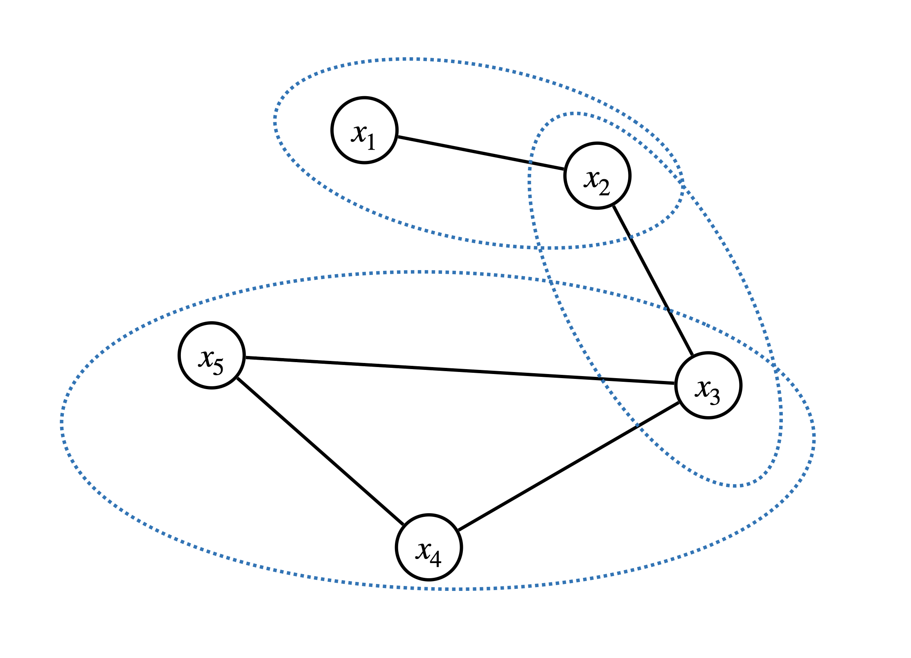
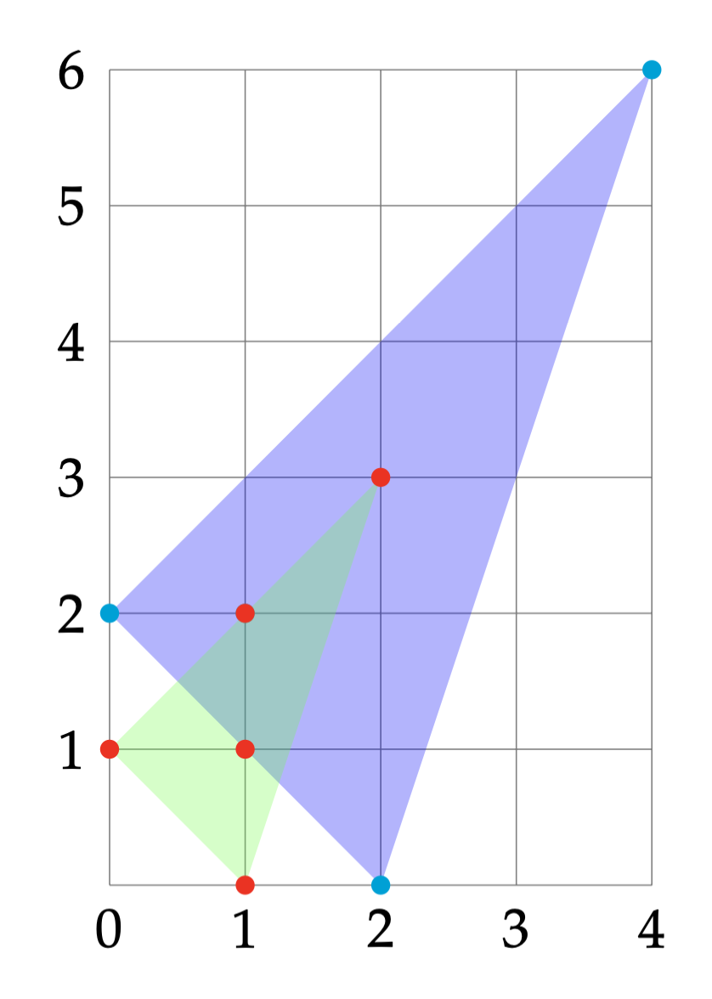

# Exploit Structure {#Structure}

## Chordal Graphs and Sparse SDPs

The following discussion mostly follows [@zheng20mp-chordal] and [@vandenberghe15fto-chordal].

Consider an undirected graph $\calG = (\calV,\calE)$, where $\calV=\{1,\dots,n \}$ is the node set, and $\calE \subseteq \calV \times \calV$ is the edge set. A graph $\calG$ is called **complete**, or **fully-connected**, if any pair of nodes are connected by an edge. 

A subset $\calC \subseteq \calV$ is called a **clique** if the subgraph induced by $\calC$ is complete, i.e., for any $i \neq j \in \calC$, $(i,j) \in \calE$ is connected. The number of nodes in $\calC$ is denoted $\abs{\calC}$. A clique $\calC$ is called a **maximal clique** if $\calC$ is not part of a larger clique.

A **cycle** of length $K$ in a graph $\calG$ is a set of distinct notes $\cbrace{v_1,v_2,\dots,v_K}$ such that $(v_K,v_1) \in \calE$ and $(v_i,v_{i+1}) \in \calE$ for any $i=1,\dots,K-1$. A **chord** in a cycle is an edge joining two non-adjacent nodes.

::: {.definitionbox}
::: {.definition #ChordalGraph name="Chordal Graph"}
An undirected graph is called chordal if every cycle of length greater than or equal to $4$ has at least one chord.
:::
:::

Given a graph, testing chordality can be done efficiently. If a graph is chordal, then all its maximal cliques can be enumerated in linear time in the number of nodes and edges [@gavril72sic-algorithms]. 

If a graph is not chordal, then it can be made chordal by adding edges, known as **chordal extension**. Finding the minimal chordal extension of a graph, i.e., making the graph chordal by adding the minimum number of edges, is NP-complete [@arnborg87siadm-complexity]. However, there exist good heuristics that can find a reasonably good chordal extension quickly [@vandenberghe15fto-chordal].

Given a symmetric matrix $X \in \sym{n}$, the sparsity pattern of $X$ can be naturally represented as an undirected graph. To do so, we can have the node set $\calV = [n]$ and connect the node $i$ and the node $j$ if and only if $X_{ij} \neq 0$. Let $\calG = (\calV, \calE)$ be the graph created by such a procedure.

Let $\calC \subset \calV$ be a clique of the graph, we can create a matrix $E_{\calC} \in \Real{\abs{\calC} \times n}$ as follows 
$$
(E_{\calC})_{ij} = \begin{cases}
1 & \text{if }\calC(i) = j \\
0 & \text{otherwise}
\end{cases},
$$
where $\calC(i)$ denotes the $i$-th vertex in $\calC$. With this matrix $E_{\calC}$, we can perform two operations

- Given $X \in \sym{n}$, $E_{\calC} X E_{\calC}\tran \in \sym{\abs{\calC}}$ extracts the principal submatrix of $X$ with rows and columns indexed by the vertices in $\calC$.

- Given $Y \in \sym{\abs{\calC}}$, $E_{\calC}\tran Y E_{\calC} \in \sym{n}$ creates a larger matrix whose principal submatrix indexed by $\calC$ are populated by the values of $Y$, and zero everywhere else. 

Given $\calG = (\calV,\calE)$, let $\calE^* = \calE \cup \cbrace{(i,i), i \in \calV}$ be the set of edges including self-loops. Consider the subspace of $\sym{n}$ defined as 
$$
\sym{n}(\calE,0) = \cbrace{ X \in \sym{n} \mid X_{ij}=X_{ji} = 0 \text{ if } (i,j) \neq \calE^*}.
$$
In words, the subspace $\sym{n}(\calE,0)$ contains all symmetric matrices with non-zero entries corresponding to only the edges in $\calE^*$. This subspace is also called symmetric matrices with sparsity pattern $\calG$.

We can then consider the PSD matrices with sparsity pattern $\calG$ defined as 
\begin{equation}
\psd{n}(\calE,0) = \cbrace{ X \in \sym{n}(\calE,0) \mid X \succeq 0}
(\#eq:psd-sparsity)
\end{equation}
which contains $n \times n$ PSD matrices with non-zero entries only in $\calE^*$. It is easy to check that $\psd{n}(\calE,0)$ is a proper cone.

Correspondingly, we can consider another cone 
\begin{equation}
\psd{n}(\calE,?) = \Pi_{\sym{n}(\calE,0)}(\psd{n}),
(\#eq:psd-sparsity-dual)
\end{equation}
where the projection is done according to the usual Frobenius norm. Clearly, given a PSD matrix $X_+$, its projection onto $\sym{n}(\calE,0)$ is just setting the entries of $X_+$ not in $\calE^*$ to zero. In other words, every element $X \in \psd{n}(\calE,?)$, while itself may not be PSD, must admit a **positive semidefinite completion**.

::: {.theorembox}
::: {.lemma #SparsePSDCone name="Sparse PSD Cones"}
$\psd{n}(\calE,0)$ and $\psd{n}(\calE,?)$ are dual to each other, i.e., 
$$
\psd{n}(\calE,?) = \cbrace{X \in \sym{n}(\calE,0)  \mid \inprod{X}{Z} \geq 0, \forall Z \in \psd{n}(\calE,0)}.
$$
$$
\psd{n}(\calE,0) = \cbrace{X \in \sym{n}(\calE,0) \mid \inprod{X}{Z} \succeq 0, \forall Z \in \psd{n}(\calE,?)}.
$$
:::
:::

When the graph $\calG = (\calV,\calE)$ is chordal, the cones $\psd{n}(\calE,0)$ and $\psd{n}(\calE,?)$ can be efficiently decomposed into smaller PSD cones. 

::: {.theorembox}
::: {.theorem #DecomposeSparsePSDCones name="Decomposition of Sparse PSD Cones"}
Suppose the graph $\calG = (\calV,\calE)$ is chordal and let $\cbrace{\calC_1,\dots,\calC_p}$ be the set of maximal cliques of $\calG$. Then we have,

1. $X \in \psd{n}(\calE,?)$ if and only if 
\begin{equation}
E_{\calC_k} X E_{\calC_k}\tran \in \psd{\abs{\calC_k}}, \quad k=1,\dots,p,
(\#eq:principal-submatrix-psd)
\end{equation}
i.e., the principal submatrices of $X$ corresponding to the maximal cliques are PSD.

2. $Z \in \psd{n}(\calE,0)$ if and only if 
\begin{equation}
Z = \sum_{k=1}^p E_{\calC_k}\tran Z_k E_{\calC_k}, 
(\#eq:psd-decomposition)
\end{equation}
for some PSD matrices 
$$
Z_k \in \psd{\abs{\calC_k}}, \quad k=1,\dots,p,
$$
i.e., $Z$ admits a decomposition into smaller PSD matrices. 
:::
:::

You should verify that when \@ref(eq:principal-submatrix-psd) and \@ref(eq:psd-decomposition) hold, $\inprod{X}{Z}\geq 0$.

We now consider the standard SDP pair 
\begin{equation}
\begin{split}
\min_{X \in \sym{n}} & \quad \inprod{C}{X} \\
\subject & \quad \inprod{A_i}{X} = b_i, i=1,\dots,m \\
& \quad X \succeq 0
\end{split}
(\#eq:primal-sdp-sparse)
\end{equation}
and 
\begin{equation}
\begin{split}
\max_{y \in \Real{m}, Z \in \sym{n}} & \quad \inprod{b}{y} \\
\subject & \quad C - \sum_{i=1}^m y_i A_i = Z \\
& \quad Z \succeq 0
\end{split}.
(\#eq:dual-sdp-sparse)
\end{equation}
We say the SDP pair satisfies the **aggregate sparsity pattern** described by the graph $\calG=(\calV,\calE)$ if
\begin{equation}
C \in \sym{n}(\calE,0), \quad A_i \in \sym{n}(\calE,0), i=1,\dots,m.
(\#eq:aggregate-sparsity-pattern)
\end{equation}
We assume the sparsity pattern $\calG$ is chordal, or can be made chordal by some chordal extension. Note that under the sparsity pattern \@ref(eq:aggregate-sparsity-pattern), it is clear that 
$$
Z = C - \sum_{i=1}^m y_i A_i \in \sym{n}(\calE,0)
$$
must also satisfy the sparsity pattern. Therefore, the dual SDP is equivalent to 
\begin{equation}
\boxed{
\begin{split}
\max_{y,Z} & \quad \inprod{b}{y} \\
\subject & \quad C - \sum_{i=1}^m y_i A_i = Z \\
& \quad Z \in \psd{n}(\calE,0)
\end{split}
}
(\#eq:dual-sdp-sparse-rewritten)
\end{equation}
By standard conic duality (again!), since the dual cone of $\psd{n}(\calE,0)$ is $\psd{n}(\calE,?)$, we know the primal SDP must be equivalent to 
\begin{equation}
\boxed{
\begin{split}
\min_{X } & \quad \inprod{C}{X} \\
\subject & \quad \inprod{A_i}{X} = b_i, i=1,\dots,m \\
& \quad X \in \psd{n}(\calE,?)
\end{split}
}
(\#eq:primal-sdp-sparse-rewritten)
\end{equation}
This makes sense because even if the matrix $X$ is dense, since the cost matrix $C$ and the constraint matrices $A_i$ all satisfy the aggregate sparsity pattern, what matters in $X$ are only those belong to $\calE^*$ as long as $X$ admits a positive semidefinite completion.

The new conic pair \@ref(eq:primal-sdp-sparse-rewritten) and \@ref(eq:dual-sdp-sparse-rewritten) are not standard SDPs, we can convert them to standard SDPs, in two ways.

**Convert the primal**. From Theorem \@ref(thm:DecomposeSparsePSDCones), we know $X \in \psd{n}(\calE,?)$ if and only if \@ref(eq:principal-submatrix-psd) holds. Therefore, we can create redundant variables $X_1,\dots,X_p$ such that 
$$
X \in \psd{n}(\calE,?) \quad \Leftrightarrow \begin{cases}
E_{\calC_k} X E_{\calC_k}\tran = X_k \\
X_k \succeq 0
\end{cases}, k=1,\dots,p.
$$
Therefore, the primal is equivalent to 
\begin{equation}
\begin{split}
\min_{X,X_1,\dots,X_p} & \quad \inprod{C}{X} \\
\subject & \quad \inprod{A_i}{X} = b_i, i=1,\dots,m \\
& \quad E_{\calC_k} X E_{\calC_k}\tran = X_k, k=1,\dots,p \\
& \quad X_1,\dots,X_p \succeq 0
\end{split}
(\#eq:primal-sdp-sparse-rewritten-1)
\end{equation}
This formulation, however, has free variables $X$, which can be marginalized out, arriving the final form 
\begin{equation}
\begin{split}
\min_{X_1,\dots,X_p} & \quad \sum_{k=1}^p \inprod{C_k}{X_k} \\
\subject & \quad \sum_{k=1}^p \inprod{A_{i,k}}{X_k} = b_i, i=1,\dots,m \\
& \quad E_{\calC_k \cap \calC_j} \left( E_{\calC_k}\tran X_k E_{\calC_k} - E_{\calC_j}\tran X_j E_{\calC_j} \right)E_{\calC_k \cap \calC_j}\tran = 0, \forall j \neq k, \calC_j \cap \calC_k \neq \emptyset \\
& \quad X_1,\dots,X_p \succeq 0
\end{split}
(\#eq:primal-sdp-sparse-rewritten-final)
\end{equation}
This conversion was first proposed by [@fukuda01siopt-exploiting].


**Convert the dual**. From Theorem \@ref(thm:DecomposeSparsePSDCones), we know $Z \in \psd{\calE,0}$ if and only if \@ref(eq:psd-decomposition) holds. Therefore, the dual SDP can be equivalently written as 
\begin{equation}
\begin{split}
\max_{y,Z_1,\dots,Z_p} & \quad \inprod{b}{y} \\
\subject & \quad C - \sum_{i=1}^m y_i A_i = \sum_{k=1}^p E_{\calC_k}\tran Z_k E_{\calC_k} \\
& \quad Z_1,\dots,Z_p \succeq 0
\end{split}
(\#eq:dual-sdp-sparse-rewritten-final)
\end{equation}
which can be written as a standard SDP using a trick called dualization [@zhang2021sparse].

## Sparse Polynomial Optimization

Consider the basic closed semialgebraic set 
\begin{equation}
S = \cbrace{x \in \Real{n} \mid g_i(x) \geq 0, i=1,\dots,l}.
(\#eq:constraint-set-sparse)
\end{equation}
If the set $S$ is Archimedean, then Putinar's Positivstellensatz states that any polynomial $p(x)$ strictly positive on $S$ must admit an SOS representation
\begin{equation}
p(x) = \sigma_0(x) + \sum_{i=1}^l \sigma_i(x) g_i(x), \quad \sigma_i(x) \in \Sigma[x], i=0,\dots,l
(\#eq:Putinar-Psatz-restate)
\end{equation}
where the $\sigma_i$'s are SOS polynomials in $x$. Using this result, the moment-SOS hierarchy for polynomial optimization has been derived.

It should be noted that, when the dimension $n$ of $x$ is large, the size of the gram matrix of $\sigma_0(x)$ grows very fast with the relaxation order, and hence quickly becomes too large to be solved by existing SDP solvers like MOSEK.

In this section, we will show that when the polynomials $p$ and $\cbrace{g_i}_{i=1}^l$ are sparse in some sense, then the moment-SOS hierarchy can be made much more tractable. The discussion below easily generalizes to the case where $S$ also has equality constraints.

### Sparse SOS Representation 

Let us first consider the case with three sets of variables. Let $\poly{x,y,z}$ be the ring of real polynomials in three sets of variables $x \in \Real{n_x}$, $y \in \Real{n_y}$, and $z \in \Real{n_z}$. Let $S_{xy} \subset \Real{n_x + n_y}$, $S_{yz} \subset \Real{n_y + n_z}$, and $S \subset \Real{n_x + n_y + n_z}$ be the compact basic closed semialgebraic sets defined as follows
\begin{equation}
\begin{split}
S_{xy} &= \cbrace{(x,y) \in \Real{n_x + n_y} \mid g_i(x,y) \geq 0, i \in I_{xy}} \\
S_{yz} &= \cbrace{(y,z) \in \Real{n_y + n_z} \mid h_i(y,z) \geq 0, i \in I_{yz}} \\
S &= \cbrace{(x,y,z) \in \Real{n_x + n_y + n_z} \mid (x,y) \in S_{xy}, (y,z) \in S_{yz}}
\end{split}
(\#eq:three-sets-definition)
\end{equation}
for some polynomials $g_i \in \poly{x,y}$ and $h_i \in \poly{y,z}$ and some index sets $I_{xy}$ and $I_{yz}$. Denote by $\Sigma[x,y]$ and $\Sigma[y,z]$ to be the sets of SOS polynomials in $(x,y)$ and $(y,z)$, respectively. 

Let us now consider the following two quadratic modules
\begin{equation}
\begin{split}
\qmodule[g] &= \lcbrace{ \sigma_0 + \sum_{i \in I_{xy}} \sigma_i g_i \mid \sigma_i \in \Sigma[x,y], i\in \cbrace{0} \cup I_{xy} } \\
\qmodule[h] &= \lcbrace{ \sigma_0 + \sum_{i \in I_{yz}} \sigma_i h_i \mid \sigma_i \in \Sigma[y,z], i\in \cbrace{0} \cup I_{yz} }
\end{split}.
(\#eq:quadratic-modules-separate-three-sets)
\end{equation}

We have the following result that gives a sparse Putinar's P-satz.

::: {.theorembox}
::: {.theorem #SparsePutinarThreeSets name="Sparse Putinar's Positivstellensatz"}

Let $S$, $S_{xy}$, and $S_{yz}$ be as defined in \@ref(eq:three-sets-definition). Assume that both $S_{xy}$ and $S_{yz}$ are Archimedean (e.g., with a ball constraint $M - \norm{(x,y)}^2$ and $M - \norm{(y,z)}^2$).

Given any $p \in \poly{x,y} + \poly{y,z}$, i.e., a polynomial $p(x,y,z)$ that can be decomposed as 
$$
p(x,y,z) = p_1(x,y) + p_2(y,z).
$$
If $p(x,y,z)$ is strictly positive on $S$, then 
$$
p \in \qmodule[g] + \qmodule[h].
$$
:::
:::

Let us contrast the sparse Putinar's P-satz in Theorem \@ref(thm:SparsePutinarThreeSets) with the dense version in \@ref(eq:Putinar-Psatz-restate). 

Invoking the dense version, we know that any $p(x,y,z)$ positive on $S$ has the decomposition 
\begin{equation}
p = \sigma_0(x,y,z) + \sum_{i \in I_{x,y}} \sigma_i(x,y,z) g_i(x,y) + \sum_{i \in I_{yz}} \sigma_i(x,y,z) h_i(y,z), \quad \sigma_i \in \Sigma[x,y,z].
(\#eq:dense-Putinar-three-sets)
\end{equation}
For a fixed relaxation order, the gram matrix of the SOS polynomial $\sigma_0(x,y,z)$ has size 
$$
s(n_x + n_y + n_z + \kappa, \kappa).
$$

Invoking the sparse version in Theorem \@ref(thm:SparsePutinarThreeSets), we obtain the following decomposition
\begin{equation}
\begin{split}
p = \sigma_0(x,y) + & \sum_{i \in I_{xy}} \sigma_i(x,y) g_i(x,y) + \\ & q_0(y,z) + \sum_{i \in I_{yz}} q_i(y,z) h_i(y,z), \quad \sigma_i \in \Sigma[x,y], q_i \in \Sigma[y,z].
\end{split}
(\#eq:sparse-Putinar-three-sets)
\end{equation}
For the same relaxation order, the gram matrix of the SOS polynomial $\sigma_0(x,y)$ has size 
$$
s(n_x + n_y + \kappa,\kappa),
$$
and the gram matrix of the SOS polynomial $q_0(y,z)$ has size 
$$
s(n_y + n_z + \kappa, \kappa).
$$

At the same relaxation order, the SOS program (conic optimization) \@ref(eq:sparse-Putinar-three-sets) is much smaller than that in \@ref(eq:dense-Putinar-three-sets)!

::: {.examplebox}
::: {.example #SparseSOSThreeSets name="Sparse SOS Representation"}
Consider 
$$
S = \cbrace{(x,y,z) \mid g(x,y)= 1- x^2 - y^2 \geq 0, h(y,z) = 1 - y^2 - z^2 \geq 0},
$$
and
$$
p(x,y,z) = \underbrace{1 + x^2 y^2 - x^2 y^4}_{\in \poly{x,y}} + \underbrace{y^2 + z^2 - y^2 z^4}_{ \in \poly{y,z}}.
$$

We can find a sparse SOS representation of $p(x,y,z)$ as 
$$
p = \underbrace{1 + x^4 y^2 + x^2 y^2 (1 - x^2 - y^2)}_{\in \qmodule[g]} + \underbrace{y^4 z^2  + y^2 z^2(1-y^2 - z^2)}_{\in \qmodule[h]}.
$$
:::
:::

Let us generalize the result above to more than three sets of variables.

Consider a constraint subset $S \subset \Real{n}$ as defined by \@ref(eq:constraint-set-sparse). Denote $I_0 = [n] = \cbrace{1,\dots,n}$. Assume $I_0$ can be written as the union of $K$ subsets
$$
I_0 = \cup_{k=1}^K I_k, \quad I_k \subset I_0.
$$
Let the size of $I_k$ be $n_k < n$. Denote 
$$
x(I_k) = \cbrace{x_i \mid i \in I_k}
$$
as the subset of variables with indexes in $I_k$. The dimension of $x(I_k)$ is $n_k$. Denote by $\poly{x(I_k)}$ be the ring of real polynomials in the $n_k$ variables $x(I_k)$. 

With this setup, we will make the following definition about the sparsity of the set $S$ as defined in \@ref(eq:constraint-set-sparse).

::: {.definitionbox}
::: {.definition #CorrelativeSparsity name="Correlative Sparsity"}
Consider the constraint set $S$ defined in \@ref(eq:constraint-set-sparse), and a polynomial $p \in \poly{x}$. $S$ and $p$ are said to satisfy correlative sparsity, or chordal sparsity, if the following conditions hold:

1. For any constraint $g_i(x),i=1,\dots,l$, there exists $k \in [K]$ such that $g_i(x)$ only involves variables $x(I_k)$, i.e., $g_i(x)$ can be written as $g_i(x(I_k))$ for some $I_k$

2. The polynomial $p(x)$ can be decomposed as 
$$
p = \sum_{k=1}^K p_k, \quad p_k \in \poly{x(I_k)},k=1,\dots,K.
$$

3. The partition $I_1,\dots,I_K$ satisfies the running intersection property (RIP), i.e., for every $k=1,\dots,K-1$
$$
(\cup_{j=1}^k I_k ) \cap I_{k+1} \subseteq I_s, \quad \text{for some } s \leq k.
$$
:::
:::

When correlative sparsity holds, we can partition the set of all constraints $\cbrace{1,\dots,l}$ into $K$ subsets $J_k$ such that 
\begin{equation}
\cup_{k=1}^K J_k = \cbrace{1,\dots,l}, \quad g_i(x) \equiv g_i(x(I_k)), \forall i \in J_k, k=1,\dots,K
(\#eq:partition-constraints)
\end{equation}
and every constraint $g_i, i \in J_k$ only involves variables $x(I_k)$.

We are now ready to state the sparse Putinar's Positivstellensatz.

::: {.theorembox}
::: {.theorem #SparsePutinar name="Sparse Putinar's Positivstellensatz"}
Let $S$ and $p$ satisfy correlative sparsity in Definition \@ref(def:CorrelativeSparsity), and $J_1,\dots,J_K$ be as in \@ref(eq:partition-constraints). 

Assume that 
$$
S_{x(I_k)} := \cbrace{ y \in \Real{n_k} \mid g_i(y) \geq 0, i \in J_k }
$$
is Archimedean for every $k=1,\dots,K$.

Then, if $p(x)$ is strictly positive on $S$, it admits a representation 
$$
p(x) = \sum_{k=1}^K \left( \sigma_k + \sum_{i \in J_k} \sigma_{ki} g_i  \right), \quad \sigma_k, \sigma_{ki} \in \Sigma[x(I_k)], k=1,\dots,K.
$$
:::
::: 

A few remarks about the sparse Putinar's Positivstellensatz:

- The sparse P-satz is more efficient than the dense P-satz, in the sense that every SOS multiplier $\sigma_k, \sigma_{ki}$ only involves the subset of variables $x(I_k)$ of dimension $n_k < n$.

- The running intersection property (RIP) in Definition \@ref(def:CorrelativeSparsity) is important. Without RIP, the sparse Putinar's P-satz in general fails to hold, and one can give counterexamples, such as Example 12.1.4 in [@nie23book-moment]. For the special case of three sets of variables discussed above, one can easily check that RIP holds:
$$
(x,y) \cap (y,z) = y \subset (x,y).
$$

- The constraint index sets $\cbrace{J_1,\dots,J_K}$ can have intersections. For example, for certain $g_i(x)$, if there exist both $k_1$ and $k_2$ such that $g_i(x) \in \poly{x(I_{k_1})}$ and $g_i(x) \in \poly{x(I_{k_2})}$ both hold, then $J_{k_1}$ and $J_{k_2}$ can have intersections. 

- When the Archimedean condition does not hold, but correlative sparsity exists, one can derive a similar version of the sparse Schmudgen's Positivstellensatz, where the quadratic modules are replaced with preorders.

::: {.examplebox}
::: {.example #SparsePutinar name="Sparse Putinar's Positivstellensatz"}
Let $x = (x_1,\dots,x_5)$, and 
\begin{equation}
\begin{split}
g_1(x) &= 1 - x_1^2 - x_2^2 \\
g_2(x) &= 1 - x_2^4 x_3^4 - x_3^2 \\
g_3(x) &= 1 - x_3^2 - x_4^2 - x_5^2
\end{split}.
\end{equation}
Consider the polynomial $p(x)$ 
$$
p(x) = 1 + x_1^2 x_2^2 + x_2^2 x_3^2 + x_3^2 - x_3^2 x_4^2 - x_3^2 x_5^2.
$$
We can create the partition
$$
I_1 = \cbrace{1,2}, \quad I_2 = \cbrace{2,3}, \quad I_3 = \cbrace{3,4,5},
$$
and verify that they satisfy RIP:
$$
I_1 \cap I_2 = \cbrace{2} \subset I_1, \quad (I_1 \cup I_2) \cap I_3 =\cbrace{3} \subset I_2.
$$
Every polynomial $g_i$ only involves a subset of variables:
$$
J_1 = {1}, \quad J_2 = {2}, \quad J_3 = {3}.
$$
The polynomial $p(x)$ can be decomposed as 
$$
p(x) = \underbrace{(1 + x_1^2 x_2^2)}_{p_1} + \underbrace{(x_2^2 x_3^2)}_{p_2} + \underbrace{(x_3^2 - x_3^2 x_4^2 - x_3^2 x_5^2)}_{p_3}.
$$
Invoking Theorem \@ref(thm:SparsePutinar), we can find a sparse SOS representation
\begin{equation}
\begin{split}
p(x) = & 1 + x_1^4 x_2^2 + x_1^2 x_2^4 + x_1^2 x_2^2 g_1(x) \\
& + x_2^6 x_3^6 + x_2^2 x_3^4 + x_2^2 x_3^2 g_2(x) \\
& + x_3^4 + x_3^2 g_3(x).
\end{split}
\end{equation}
:::
:::

One may wonder how can we find such a partition $I_1,\dots,I_K$? It turns out this is exactly a graph problem! In particular, we can perform the following procedure.

1. Create a graph $\calG$ with $\calV = [1,\dots,n]$ nodes 

2. For every $g_i(x)$, find the minimum subset of variables that $g_i(x)$ involves, say $x(I_k)$. Connect all pairs of nodes in $I_k$. 

3. Write $p(x) = \sum_{\alpha} p_{\alpha} x^{\alpha}$ with nonzero coefficients $p_{\alpha}$. For every term $x^{\alpha}$, find the variables with nonzero exponents, say $\alpha_i \neq 0, \forall i \in I_{\alpha}$. Connect all pairs of nodes in $I_{\alpha}$. 

We obtain a graph from the procedure described above. In particular, for the problem in Example \@ref(exm:SparsePutinar), we obtain a graph in Fig. \@ref(fig:CorrelativeSparsity). This graph is a chordal graph. If it is not chordal, we can find chordal extension.

```{r CorrelativeSparsity, out.width='70%', fig.show='hold', fig.cap='Correlative sparsity and chordal graph.', fig.align='center', echo=FALSE}

```

Now in Fig. \@ref(fig:CorrelativeSparsity), one can see that $I_1,I_2,I_3$ correspond to exactly the three maximal cliques of the chordal graph and they satisfy RIP. Indeed, this is true for any chordal graph.

::: {.theorembox}
::: {.theorem #RIPChordal name="RIP and Chordal Graph"}
A connected graph is chordal if and only if its maximal cliques, after an appropriate ordering, satisfy the running intersection property.
:::
:::

Therefore, after forming the connectivity graph and make it chordal, one can always find its maximal cliques and order them in a way that satisfies the RIP.

With the sparse Putinar's P-satz introduced in Theorem \@ref(thm:SparsePutinar), we can derive the sparse SOS relaxations for POPs. Consider the POP 
\begin{equation}
\min_{x \in S} p(x)
(\#eq:pop-restate-correlative-sparse)
\end{equation}
with $S$ defined as in \@ref(eq:constraint-set-sparse). If $S$ and $p$ satisfy correlative sparsity, then the $\kappa$-th order SOS relaxation reads 
\begin{equation}
\begin{split}
\max & \quad \gamma \\
\subject & \quad p(x) - \gamma \in \qmodule[\cbrace{g_i}_{i \in I_1}]_{2\kappa} + \cdots + \qmodule[\cbrace{g_i}_{i \in I_K}]_{2\kappa},
\end{split}
(\#eq:sparse-SOS-relaxation-Putinar)
\end{equation}
which is an instance of SOS programming.

### Sparse Moment Relaxation 

What is the dual of the sparse SOS relaxation \@ref(eq:sparse-SOS-relaxation-Putinar)?

Consider the POP \@ref(eq:pop-restate-correlative-sparse) and assume that it satisfies the correlative sparsity condition in Definition \@ref(def:CorrelativeSparsity). Define 
\begin{equation}
S_k := \cbrace{x(I_k) \in \Real{n_k} \mid g_i(x(I_k)) \geq 0, i \in J_k}, \quad k=1,\dots,K.
(\#eq:projected-subset)
\end{equation}

Recall that, for any POP \@ref(eq:pop-restate-correlative-sparse), let $\calP(S)$ be the space of all possible (nonnegative) measures supported on $S$, there exists an equivalent linear programming formulation over measures
\begin{equation}
\begin{split}
\min_{\mu \in \calP(S)} & \quad \int_{S} p(x) d \mu(x) \\
\subject & \quad \int_S 1 d\mu(x) = 1.
\end{split}
(\#eq:measure-lp-dense-restate)
\end{equation}

We will show that, when correlative sparsity exists, there exists a sparse infinite-dimensional linear programming formulation for the POP \@ref(eq:pop-restate-correlative-sparse) that is equivalent to the dense formulation \@ref(eq:measure-lp-dense-restate). 

Towards this, we will denote $\calP(S_k)$ as the space of measures supported on $S_k,k=1,\dots,K$. Then, we will define the projection $\pi_k: \calP(S) \rightarrow \calP(S_k)$ from the space of measures supported on $S$ onto the space of measures supported on $S_k$. In particular, for any $\mu \in \calP(S)$, and any set $B \subseteq S_k$, we have 
$$
\pi_k \mu(B) := \mu \left( \cbrace{x \mid x \in S, x(I_k) \in B} \right).
$$
Similarly, for any $j\neq k \in [K]$ such that $I_j \cap I_k \neq \emptyset$, we define 
$$
S_{jk} = S_{kj} = \cbrace{ x(I_j \cap I_k) \mid x(I_j) \in S_j, x(I_k) \in S_k},
$$
and the projection from the space of measures supported on $S$ onto the space of measures supported on $S_{jk}$ as
$$
\pi_{jk}\mu(B) := \mu \left( \cbrace{x \mid x \in S, x(I_j \cap I_k) \in B} \right)
$$
for any $B \subseteq S_{ij}$.

Now consider the following infinite-dimensional LP
\begin{equation}
\begin{split}
\min_{\mu_k, k=1,\dots,K} & \quad \int_{S_k} p_k(x)  d \mu_k (x) \\
\subject & \quad \pi_{kj} \mu_j = \pi_{jk} \mu_k, \quad \forall j \neq k, \calI_j \cap \calI_k \neq \emptyset \\
& \quad \int_{S_k} 1 d \mu_k(x) = 1, \quad k=1,\dots,K \\
& \quad \mu_k \in \calP(S_k), \quad k=1,\dots,K
\end{split}
(\#eq:measure-lp-sparse)
\end{equation}

::: {.theorembox}
::: {.theorem #SparseInfDimLP name="Sparse Infinite-Dimensional LP"}
Consider the POP \@ref(eq:pop-restate-correlative-sparse) that satisfies the correlative sparsity pattern in Definition \@ref(def:CorrelativeSparsity). Assume every $S_k$ defined in \@ref(eq:projected-subset) is compact. Then the global minimum of the dense infinite-dimensional LP \@ref(eq:measure-lp-dense-restate) is equal to the global minimum of the sparse infinite-dimensional LP \@ref(eq:measure-lp-sparse), both of which are the same as the global minimum of the POP \@ref(eq:pop-restate-correlative-sparse).
:::
:::

The equivalence of the dense LP and the sparse LP boils down to the following Lemma.

::: {.theorembox}
::: {.lemma #MeasureFromMarginals name="Measure from Marginals"}

Let $[n] = \cup_{k=1}^K I_k$ with $n_k = \abs{I_k}$, and $S_k \subset \Real{n_k}$ be compact sets. Let $S$ be defined as 
$$
S = \cbrace{x \in \Real{n} \mid x(I_k) \in S_k, k=1,\dots,K}.
$$

Let $\mu_k \in \calP(S_k),k=1,\dots,K$ be a set of measures that satisfy the equality constraints of \@ref(eq:measure-lp-sparse). If RIP holds for $I_1,\dots,I_K$, then there exists a probability measure $\mu \in \calM(S)$ such that 
$$
\pi_k \mu = \mu_k, \quad k=1,\dots,K,
$$
i.e., $\mu_k$ is the marginal of $\mu$ on $\Real{n_k}$ with respect to variables $x(I_k)$.
:::
:::

With the sparse infinite-dimensional LP \@ref(eq:measure-lp-sparse), we can easily write down its moment relaxation. Let $y_k \in \Real{s(n_k,2\kappa)}$ be the truncated moment sequence associated with $\mu_k, k=1,\dots,K$, the semidefinite relaxation for \@ref(eq:measure-lp-sparse) reads 
\begin{equation}
\begin{split}
\min_{y_1,\dots,y_K} & \quad \sum_{k=1}^K \inprod{y_k}{\vectorize(p_k)} \\
& \quad M_\kappa[y_k] \succeq 0, \quad L_{g_j}^\kappa[y_k] \succeq 0, j\in J_k, k=1,\dots,K \\
& \quad y_{k,0} = 1,\quad k=1,\dots,K \\
& \quad \ell_{y_k} (x^\alpha) = \ell_{y_j} (x^\alpha), \quad \alpha \in \calF_{n,2\kappa}, \supp(\alpha) \in I_j \cap I_k, \forall j \neq k \in [K], I_j \cap I_k \neq \emptyset
\end{split}
(\#eq:sparse-moment-relaxation)
\end{equation}
which is an SDP with $K$ positive semidefinite constraints, each one corresponding to a moment matrix $M_{\kappa}[y_k],k=1,\dots,K$. The last constraint in \@ref(eq:sparse-moment-relaxation) ensures that when two measures $\mu_j$ and $\mu_k$ have overlapping coordinates, their moments in the shared coordinates are equal to other, which corresponds to the first equality constraints in the original sparse LP \@ref(eq:measure-lp-sparse).

### Term Sparsity 

In the dense moment-SOS hierarchy and the correlative sparsity based moment-SOS hierarchy, the monomial basis has always been the vector of standard monomials, namely, $[x]_{\kappa}$ in the case of dense moment-SOS, and $[x(I_k)]_{\kappa},k=1,\dots,K$ in the case of sparse moment-SOS.  

We then ask the question, could we use only a subset of the standard monomials? This is another type of sparsity called **term sparsity**.

We will give a brief discussion of term sparsity in the case of unconstrained polynomial optimization:
\begin{equation}
\min_{x \in \Real{n}} \quad p(x).
(\#eq:unconstrained-pop)
\end{equation}
The $\kappa$-order SOS relaxation (using Putinar's Positivstellensatz) to \@ref(eq:unconstrained-pop) is 
\begin{equation}
\begin{split}
\max & \quad \gamma \\
\subject & \quad p(x) - \gamma = [x]_\kappa\tran Q [x]_\kappa \\
& \quad Q \succeq 0
\end{split}.
(\#eq:unconstrained-pop-sos)
\end{equation}

The following result, due to Reznick [@reznick78-extremal], allows us to use a possibly smaller set of monomials by considering the so-called **Newton Polytopes**. Given a polynomial $p = \sum_{\alpha} p_\alpha x^{\alpha}$ with nonzero $p_\alpha$'s, the support of $p$ is the set of exponents:
$$
\supp(p) = \cbrace{\alpha \mid p_\alpha \neq 0}.
$$
The Newton polytope of $p$, denoted as $\New(p)$, is the convex hull generated by points in its support.

::: {.theorembox}
::: {.theorem #NewtonPolytope name="Newton Polytope"}
If $p, q_i \in \poly{x}$, and $p = \sum_i q_i^2$, then 
$$
\New(q_i) \subset \frac{1}{2} \New(p).
$$
:::
:::

What this theorem implies is that if the support of $p$ is sparse and $p$ is SOS, then the supprt of its SOS factors $q_i$ must also be sparse. In particular, it suffices to consider a monomial basis 
\begin{equation}
\calB = \frac{1}{2} \New(p) \cap \calF_n
(\#eq:Newton-polytope)
\end{equation}
when searching for SOS factorization of $p$.


::: {.examplebox}
::: {.example #NewtonPolytope name="Newton Polytope"}
Consider the polynomial
$$
p(x) = 4 x_1^4 x_2^6 + x_1^2 - x_1 x_2^2 + x_2^2.
$$
The support of $p$ is 
$$
\supp(p) = \cbrace{(4,6), (2,0), (1,2), (0,2)}.
$$
We can therefore choose the monomial basis according to \@ref(eq:Newton-polytope), which becomes 
$$
\calB = \cbrace{(1,0),(2,3),(0,1),(1,1),(1,2)}.
$$
This is shown in Fig. \@ref(fig:NewtonPolytope). Note that since the degree of $p$ is $10$, using the dense monomial basis would lead to 
$$
s(2,5) = \begin{pmatrix}
2 + 5 \\ 2
\end{pmatrix}= 21
$$
terms. However, the monomial basis $\calB$ found by Newton polytope has only $5$ terms.


```{r NewtonPolytope, out.width='40%', fig.show='hold', fig.cap='Newton polytope.', fig.align='center', echo=FALSE}

```

:::
:::

Let $\calB$ be the monomial basis found by using Newton polytope. The SOS relaxation that exploits term sparsity reads 
\begin{equation}
\begin{split}
\max & \quad \gamma \\
\subject & \quad p(x) - \gamma = [x]_{\calB}\tran Q [x]_{\calB} \\
& \quad Q \succeq 0
\end{split}.
(\#eq:unconstrained-pop-sos-term-sparsity)
\end{equation}
The dual moment relaxation of \@ref(eq:unconstrained-pop-sos-term-sparsity) becomes 
\begin{equation}
\begin{split}
\min_{y} & \quad \ell_y(p) \\
\subject & \quad M_{\calB}[y] \succeq 0 \\
& \quad y_0 = 1
\end{split}
(\#eq:unconstrained-pop-moment-term-sparsity)
\end{equation}
where $M_{\calB}[y]$ is the principal submatrix of the full moment matrix $M_\kappa[y]$ with rows and columns indexed by the exponents in the sparse basis $\calB$. 

Starting with the basis $\calB$, one can make it even sparser by building the term sparsity graph and exploiting chordal sparsity of that graph. I won't describe the details of that approach as it can get quite messy, please see [@magron23book-sparse] for a comprehensive treatment.

## Low-Rank SDPs 

In the previous sections of this Chapter, we discussed ways to exploit the sparsity structures that exist in SDPs and POPs. By exploiting them, we can formulate smaller SDPs --in particular SDPs with positive semidefinite constraints of smaller sizes-- that are faster to solve when using interior-point methods (IPMs).

However, even after exploiting sparsity, the SDPs may still be too large for IPMs to solve. Over the last couple of decades, there have been lots of interests in solving **low-rank SDPs**, i.e., SDPs whose optimal solutions are low-rank. These low-rank SDPs appear frequently in semidefinite relaxations of combinatorial problems, or high-order moment-SOS relaxations, as you have already seen in the Pset problems. In this section, we will introduce specialized algorithms that solve large-scale SDPs by exploiting low-rankness of the optimal solutions.


### Burer-Monteiro Factorization

One of the very first and most popular algorithms for solving low-rank SDPs is called Burer-Monteiro (B-M) factorization, first proposed by [@burer03mp-nonlinear], with subsequent analysis and improvement by [@journee10siopt-low], [@boumal16nips-non], [@cifuentes22nips-polynomial], to name a few. In what follows we describe the basic idea of B-M factorization.

Consider a standard primal SDP, restated from \@ref(eq:SDP-P)
\begin{equation}
\begin{split}
\min_{X \in \sym{n}} & \quad \inprod{C}{X} \\
\subject & \quad \inprod{A_i}{X} = b_i, i=1,\dots,m \\
& \quad X \succeq 0
\end{split}
(\#eq:SDP-P-BM)
\end{equation}
The dual to \@ref(eq:SDP-P-BM) is
\begin{equation}
\begin{split}
\min_{y \in \Real{m}, Z \in \sym{n}} & \quad \inprod{b}{y} \\
\subject & \quad C - \sum_{i=1}^m y_i A_i = Z \\
& \quad Z \succeq 0
\end{split}
(\#eq:SDP-D-BM)
\end{equation}
We assume that both \@ref(eq:SDP-P-BM) and \@ref(eq:SDP-D-BM) have strictly feasible points, and thus strong duality holds. Under this assumption, a feasible pair of primal-dual points $X$ and $(y,Z)$ is optimal if and only if
\begin{equation}
\inprod{X}{Z} = 0, \quad \Leftrightarrow \quad XZ = ZX = 0,
(\#eq:optimal-primal-dual-pair)
\end{equation}
where we have used that if the inner product of two PSD matrices is zero then their product must be the zero matrix.

Denote
\begin{equation}
r^\star = \min\cbrace{\rank (X_\star) \mid X_\star \text{ is optimal for the primal SDP}}
(\#eq:optimal-rank)
\end{equation}
as the minimum rank of the optimal solutions of \@ref(eq:SDP-P-BM). Empirically, $r^\star$ is often much smaller than $n$, the dimension of the matrix variable $X$. For example, in many computer vision and robotics problems [@rosen19ijrr-sesync] [@yang22pami-certifiably], $r^\star = 1$ despite that $n$ can be in the order of thousands. Theoretically, there is a well-known upper bound on $r^\star$, due to [@barvinok95dcg-problems] and [@pataki98mor-rank].

::: {.theorembox}
::: {.theorem #BarvinokPataki name="Barvinok-Pataki Bound"}
If the feasible set of \@ref(eq:SDP-P-BM) contains an extreme point, then 
$$
\frac{r^\star (r^\star + 1)}{2} \leq m,
$$
i.e., there exists an optimal solution $X_\star$ whose rank satisfies the above inequality.
:::
:::

Theorem \@ref(thm:BarvinokPataki) states that the existence of low-rank optimal solutions, i.e., $r^\star < n$, is a generic property of SDPs, as long as the number of equality constraints $m$ is not too large (which unfortunately does get violated in high-order moment-SOS relaxations, as $m = O(n^2)$ there). 

Motivated by the existence of low-rank optimal solutions, Burer and Monteiro proposed the following low-rank factorization formulation for the primal SDP \@ref(eq:SDP-P-BM)
\begin{equation}
\begin{split}
\min_{R \in \Real{n \times r}} & \quad \inprod{C}{RR\tran} \\
& \quad \inprod{A_i}{RR\tran} = b_i, i=1,\dots,m
\end{split}
(\#eq:B-M-factorization)
\end{equation}

Problem \@ref(eq:B-M-factorization) is a quadratically constrained quadratic program (QCQP), and 
we can easily observe that the new problem \@ref(eq:B-M-factorization) is equivalent to the SDP \@ref(eq:SDP-P-BM) if the rank $r$ of $R$ is chosen sufficiently large.

::: {.theorembox}
::: {.theorem #BMFactorization name="B-M Factorization"}
If $r$ in \@ref(eq:B-M-factorization) is chosen such that 
$$
r \geq r^\star,
$$
where $r^\star$ is defined in \@ref(eq:optimal-rank), then \@ref(eq:SDP-P-BM) is equivalent to \@ref(eq:B-M-factorization) in the sense that:

- they have the same global minimum;

- there exists $X_\star$ optimal for \@ref(eq:SDP-P-BM) such that $X_\star = R_\star R_\star\tran$ with $R_\star$ optimal for \@ref(eq:B-M-factorization);

- for any $R_\star$ that is optimal for \@ref(eq:B-M-factorization), $R_\star R_\star\tran$ is an optimal solution to \@ref(eq:SDP-P-BM).
:::
:::
::: {.proofbox}
::: {.proof}
Let $X_\star$ be an optimal solution of the SDP \@ref(eq:SDP-P-BM) with $\rank (X_\star) = r^\star$. Since $X_\star \succeq 0$, we can factorize 
$$
X_\star = \bar{R}_\star \bar{R}_\star\tran, \quad \bar{R}_\star \in \Real{n \times r^\star}.
$$
Because $r \geq r^\star$, we can pad $\bar{R}_\star$ with $r-r^\star$ columns of zeros 
$$
R_\star = \begin{bmatrix}
\bar{R}_\star & 0_{n \times (r - r^\star)}
\end{bmatrix}.
$$
It is easy to check that $R_\star$ is feasible for the QCQP \@ref(eq:B-M-factorization) (because $R_\star R_\star\tran = \bar{R}_\star \bar{R}_\star\tran$!) and it attains the same cost as $X_\star$ in the SDP \@ref(eq:SDP-P-BM). Therefore, the global minimum of the QCQP must be smaller than or equal to the global minimum of the SDP.

On the other hand, for any $R$ that is feasible for the QCQP, $X=RR\tran$ must also be feasible for the SDP and attains the same cost in the SDP as $R$ in the QCQP. This implies that the global minimum of the SDP must be smaller than or equal to the global minimum of the QCQP.


Combining the two arguments above, we conclude that the SDP and the QCQP have the same global minimum. Then, the other two statements in the theorem naturally follow.
:::
:::

Theorem \@ref(thm:BMFactorization) establishes the equivalence between the SDP \@ref(eq:SDP-P-BM) and the QCQP \@ref(eq:B-M-factorization), but the QCQP has much fewer variables than the SDP (when $r$ is chosen sufficiently small such that $r \ll n$)! In addition, the QCQP has no positive semidefinite constraints because $RR\tran \succeq 0$ by construction. 

However, if you think more carefully about the reformulation from the SDP to the QCQP, it is quite counterintuitive because now you lose convexity. Indeed, as we have seen in this class, a major benefit of SDP is that it can be used to derive convex relaxations of nonconvex optimization problems. The B-M factorization \@ref(eq:B-M-factorization), instead, writes the convex SDP back into a nonconvex problem. 

We will see that the QCQP \@ref(eq:B-M-factorization), despite being nonconvex, has very nice connections with the convex SDP that can be leveraged to solve large-scale SDPs beyond the reach of IPMs.

**Optimality conditions**. Let us first analyze the optimality conditions of the QCQP \@ref(eq:B-M-factorization) with a fixed choice of $r$. We associate each constraint in \@ref(eq:B-M-factorization) with a dual variable and form the Lagrangian
$$
L(R,y) = \inprod{C}{RR\tran} - \sum_{i=1}^m y_i \left( \inprod{A_i}{RR\tran} - b_i \right), \quad R \in \Real{n \times r}, y \in \Real{m}.
$$
Denote 
\begin{equation}
Z(y) = C - \sum_{i=1}^m y_i A_i,
(\#eq:Zofy)
\end{equation}
we can simplify the Lagrangian as 
$$
L(R,y) = \inprod{Z(y)}{RR\tran} + \inprod{b}{y}.
$$
The Lagrangian dual function is 
$$
\min_R \inprod{Z(y)}{RR\tran} + \inprod{b}{y} = \begin{cases}
\inprod{b}{y} & \text{if }Z(y) \succeq 0 \\
-\infty & \text{otherwise}
\end{cases}
$$
Therefore, the Lagrangian dual problem of the nonconvex QCQP \@ref(eq:B-M-factorization) is not surprisingly just the dual SDP \@ref(eq:SDP-D-BM), which we have already seen in Chapter \@ref(Shor).

We now state the first-order optimality conditions, which can be readily obtained by applying Theorem 12.1 in [@nocedal99book-numerical]. 

::: {.theorembox}
::: {.theorem #FirstOrderOptimality name="First-order Necessary Conditions for Local Optimality"}
Let $R_\star$ be a locally optimal solution of the QCQP \@ref(eq:B-M-factorization) and assume the linear
independence constraint qualification (LICQ) holds at $R_\star$, i.e., 
$$
\nabla_{R} (\inprod{A_i}{R_\star R_\star\tran} - b) = 2A_i R_\star, \quad i=1,\dots,m
$$
are linearly independent. Then, there must exist a unique dual variable $y_\star$ such that 
\begin{equation}
\begin{split}
\nabla_{R} L(R_\star, y_\star) = 2 Z(y_\star) R_\star = 0, \\
\inprod{A_i}{R_\star R_\star\tran} = b_i, i=1,\dots,m
\end{split}.
(\#eq:first-order-optimality-condition)
\end{equation}
:::
:::
The second condition in \@ref(eq:first-order-optimality-condition) implies $R_\star$ is feasible and the first condition in \@ref(eq:first-order-optimality-condition) states there must exist $y_\star$ such that the gradient of the Lagrangian with respect to $R$ vanishes at $R_\star$.

An immediate corollary of Theorem \@ref(thm:FirstOrderOptimality) is that if $Z(y_\star)$ happens to be positive semidefinite, then $R_\star$ is indeed the global minimizer.

::: {.theorembox}
::: {.corollary #GlobalOptimality name="Global Optimality from First-Order Conditions"}
Let $R_\star$ be a locally optimal solution of the QCQP \@ref(eq:B-M-factorization) and assume LICQ holds at $R_\star$. Let $y_\star$ be the dual variable such that $(R_\star,y_\star)$ satisfy the first-order optimality conditions in \@ref(eq:first-order-optimality-condition).

If 
$$
Z(y_\star) \succeq 0,
$$
then $R_\star$ is a global optimizer of the QCQP \@ref(eq:B-M-factorization), and $(R_\star R_\star\tran, y_\star, Z(y_\star))$ is an optimal pair of primal-dual solutions for the SDP \@ref(eq:SDP-P-BM) and \@ref(eq:SDP-D-BM).
:::
:::
::: {.proofbox}
::: {.proof}
We have that $R_\star R_\star\tran$ is feasible for the primal SDP \@ref(eq:SDP-P-BM), and $(y_\star, Z(y_\star))$ is feasible for the dual SDP \@ref(eq:SDP-D-BM) due to $Z(y_\star) \succeq 0$.

The first condition in the first-order optimization conditions \@ref(eq:first-order-optimality-condition) implies there is zero duality gap, and by \@ref(eq:optimal-primal-dual-pair), we conclude $(R_\star R_\star\tran, y_\star, Z(y_\star))$ are optimal for the convex SDPs.

However, by Theorem \@ref(thm:BMFactorization), the convex SDP is equivalent to the nonconvex QCQP, so $R_\star$ is a global minimizer of the nonconvex QCQP.
:::
:::

One should notice that, when LICQ holds at $R_\star$, the dual variables $y_\star$ can be solved in closed form. This can be seen by rewriting the first condition in \@ref(eq:first-order-optimality-condition) as 
\begin{equation}
\left( C - \sum_{i=1}^m y_{\star,i} A_i \right) R_\star = 0 \Leftrightarrow \sum_{i=1}^m y_{\star,i} (A_i R_\star) = C R_\star
(\#eq:solve-dual-y-linear-system)
\end{equation}
which is a system of linear equations in $y_\star$. The LICQ condition, i.e., $A_i R_\star$'s are linearly independent, implies the solution to the above linear system is unique.

The above analysis produces a very efficient algorithm for certifying global optimality that is very popular due to [@rosen19ijrr-sesync]:

- Use a gradient-based local optimization algorithm to solve the QCQP \@ref(eq:B-M-factorization) and obtain a solution $R_\star$

- If LICQ holds at $R_\star$, solve the linear system \@ref(eq:solve-dual-y-linear-system) to obtain $y_\star$

- If $Z(y_\star)$ is positive semidefinite, global optimality of $R_\star$ is certified.

What if $Z(y_\star)$ is not positive semidefinite? Can we find a better solution than $R_\star$?

In order to do so, we need to analyze the second-order optimality conditions of the QCQP \@ref(eq:B-M-factorization).


<!-- Suppose we employ a nonlinear programming algorithm, e.g., the interior-point algorithm for constrained optimization [@nocedal99book-numerical], to solve the QCQP \@ref(eq:B-M-factorization), how can we  -->


